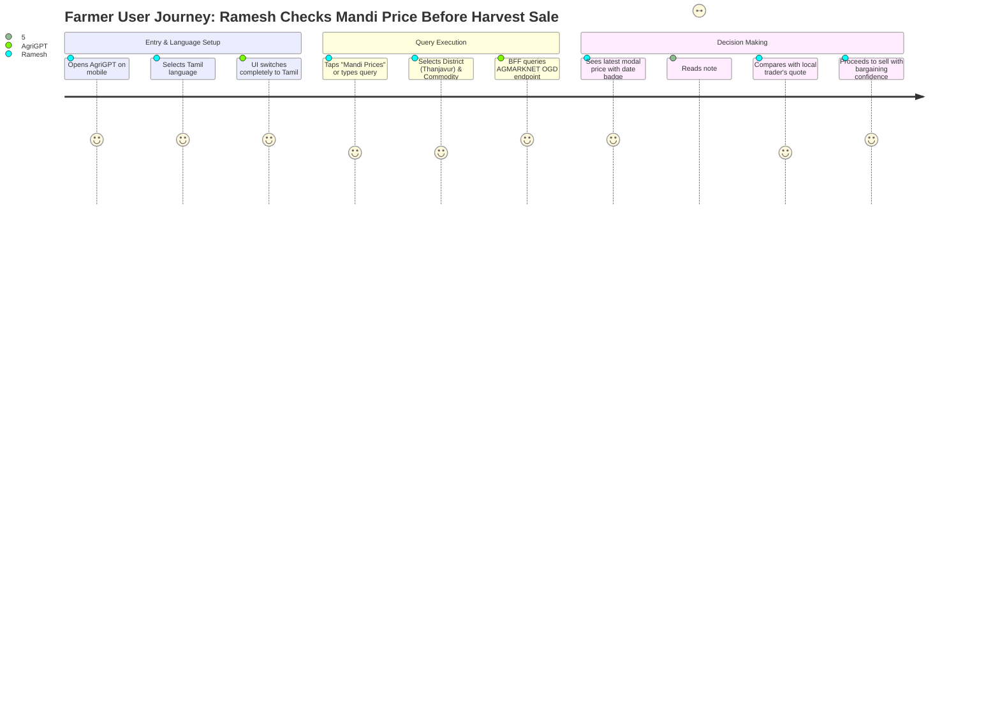

# AgriGPT — Product Requirements Document (PRD) & Software Requirements Specification (SRS)

**Document Version:** 1.0.0  
**Status:** Approved for Architectural Review  
**Project:** AgriGPT — Agricultural Intelligence Platform  
**Target Organization:** Samunnati Finance & Associated Farmer Producer Organizations (FPOs)  
**Authors:** Senior Product Engineer & Solutions Architect  

---

## 1. Executive Summary & Product Vision

### 1.1 Context & Background
Smallholder farmers across India face systemic information asymmetry. Critical agronomic decisions—such as crop sowing windows, pest treatment, harvest timing, mandi (wholesale market) selection, and government subsidy applications—are routinely made using word-of-mouth hearsay or local trader advice. This frequently leads to suboptimal yields, distress selling at depressed gate prices, and missed benefits from central and state welfare initiatives.

**Samunnati Finance** is one of India’s premier agricultural value-chain enablers, operating across 28 states and engaging over 30,000 farmer collectives (FPOs) representing more than 8 million smallholder farmers. Samunnati operates on the **AMLA** framework:
- **Aggregation:** Uniting smallholder farmers into commercially viable collectives.
- **Market Linkage:** Connecting FPOs to institutional buyers to eliminate exploitative intermediaries.
- **Advisory:** Equipping farmers and FPOs with timely knowledge, agronomic protocols, and risk mitigation tools.

**AgriGPT** is conceived as the digital intelligence engine underpinning Samunnati’s Advisory and Market Linkage pillars. 

### 1.2 Core Product Vision
AgriGPT is **not** a generic LLM wrapper, an ungrounded chat interface, or a hackathon demo. It is a **production-grade, multilingual, source-grounded agricultural intelligence system** built to deliver verified, actionable advice to Indian farmers and FPO leadership.

AgriGPT couples conversational AI with deterministic, verified data pipelines:
1. **Live Mandi Intelligence:** Real-time wholesale arrivals, min/max/modal prices from AGMARKNET with observation dates and distance indicators.
2. **Localized Weather & Agromet Warnings:** Hyperlocal forecasts, rainfall outlooks, and operational farm advisories (e.g., spraying windows).
3. **Verified Agronomy & Pest Guidance:** Curated package of practices directly sourced from ICAR and State Agricultural Universities (SAUs).
4. **Government Schemes & Crop Insurance:** Eligibility discovery, timeline alerts, and application requirements for PM-KISAN, PMFBY, and state schemes.
5. **Full Native Localization:** Complete UI and assistant interactions in **English, Tamil, Hindi, Malayalam, Telugu, and Kannada**.

---

## 2. Target Users & Stakeholder Ecosystem

```
+-----------------------------------------------------------------------------------+
|                           Samunnati Agri-Ecosystem                                |
+-----------------------------------------------------------------------------------+
        |                                       |                           |
        v                                       v                           v
+-----------------------+           +-----------------------+   +-----------------------+
|  Smallholder Farmers  |           |     FPO Managers      |   | Samunnati Field Leads |
|  (Direct End-Users)   |           | (Community Aggregator)|   |   (Krishi Mitras)     |
| - Low bandwidth (2G)  |           | - Multi-mandi analysis|   | - Group advisory      |
| - Vernacular-first    |           | - Bulk scheme filing  |   | - High-volume queries |
| - High audio affinity |           | - Desktop + Mobile    |   | - Offline-first mode  |
+-----------------------+           +-----------------------+   +-----------------------+
```

### 2.1 User Personas

#### Persona 1: Ramesh Muthusamy (Smallholder Farmer)
- **Profile:** 48 years old, owns 2.5 acres in Thanjavur district, Tamil Nadu. Cultivates Samba paddy and groundnut.
- **Technology Literacy:** Basic smartphone user (WhatsApp, YouTube). Relies heavily on Tamil voice messages. Reading long English or formal Tamil paragraphs is difficult.
- **Key Pain Point:** Local commission agents quote low prices for his groundnut harvest. He does not know whether Kumbakonam or Thanjavur APMC mandi offers better net returns after transport costs.
- **Critical Requirement:** Seamless Tamil interface, large touch targets, clear dates on mandi prices, and step-by-step pest identification for paddy stem borer.

#### Persona 2: Sunita Bai (Marginal Woman Farmer)
- **Profile:** 39 years old, cultivates 1.8 acres of soybean and wheat in Sehore district, Madhya Pradesh.
- **Technology Literacy:** Budget Android phone (2GB RAM, intermittent 3G/4G). Hindi native speaker.
- **Key Pain Point:** Pest attack on soybean crop leaves leaves yellowed. Local pesticide shop recommended an expensive chemical without explaining dosage, leading to crop scorch last year.
- **Critical Requirement:** Fast Hindi chat with structured dosage instructions, verified ICAR source badge, and weather warning if rain is expected within 24 hours of spraying.

#### Persona 3: Venkatesh Rao (FPO Board Member & Procurement Lead)
- **Profile:** 34 years old, manages a 450-member maize & chili FPO in Kurnool, Andhra Pradesh.
- **Technology Literacy:** Tech-savvy, uses laptop and smartphone. Fluent in Telugu and English.
- **Key Pain Point:** Needs to advise 400+ farmers on PMFBY crop insurance cut-off dates and aggregate market trends across Guntur, Kurnool, and Adoni mandis.
- **Critical Requirement:** Ability to compare multiple mandis side-by-side, access official PMFBY claim escalation workflows, and export verified advisory summaries for WhatsApp broadcast.

---

## 3. Core Farmer Journeys



### Journey 1: Localized Mandi Decision Making
1. **Trigger:** Farmer has harvested 20 quintals of maize and received a merchant quote.
2. **Action:** Opens AgriGPT, selects Mandi tool, specifies commodity and district.
3. **System Response:** Returns latest modal, min, and max prices from nearest regulated markets, highlighting arrival date, freshness status (e.g., "Updated yesterday"), and market distance.
4. **Outcome:** Farmer negotiates from a position of verified transparency.

### Journey 2: Grounded Agronomic Disease Diagnosis
1. **Trigger:** Fall Armyworm symptoms noticed on maize whorls.
2. **Action:** Farmer queries AgriGPT in spoken or typed vernacular: *"Corn leaves have holes and sawdust-like frass. What should I spray?"*
3. **System Response:** System matches symptom to ICAR/SAU Package of Practices, returns verified non-chemical control (pheromone traps) and approved chemical spray (active ingredient, water dilution ratio, safety gear), citing specific ICAR/KVK protocol.
4. **Outcome:** Safe, scientifically sound application without trader upselling.

### Journey 3: Government Scheme & Insurance Verification
1. **Trigger:** Unseasonal hail damages standing rabi crops.
2. **Action:** Farmer asks about insurance compensation under PMFBY.
3. **System Response:** Explains 72-hour intimation requirement, required documents (land record, bank passbook, sowing certificate), toll-free helpline, and links to official PMFBY portal.
4. **Outcome:** Timely claim submission before statutory deadline expires.

---

## 4. Functional Requirements (FR)

| Req ID | Module | Priority | Description | Acceptance Criteria |
|---|---|---|---|---|
| **FR-LANG-01** | Multilingual Core | **P0** | Complete interface localization across 6 languages: English, Tamil, Hindi, Malayalam, Telugu, Kannada. | All navigation, buttons, error messages, placeholders, badges, and empty states rendered in selected language without untranslated English fallbacks. |
| **FR-LANG-02** | Multilingual Core | **P0** | Persistent Language Preference. | Language choice persists across sessions via client cookie and profile storage without layout break or re-prompting. |
| **FR-LANG-03** | Multilingual Core | **P0** | Proper Indic Script Typography & Unicode Preservation. | All text saved, transferred, and rendered in UTF-8. No garbled text (mojibake). Line breaking respects Indic conjuncts and ligatures. |
| **FR-CHAT-01** | Conversational AI | **P0** | Multilingual Question-Answering with Intent Routing. | Queries in any of the 6 languages correctly classified into: Agronomy, Mandi, Weather, Schemes, Insurance, or General Agri. |
| **FR-CHAT-02** | Conversational AI | **P0** | Source Citation & Verification Badging. | Every factual answer must display explicit citation badges (e.g., "[ICAR POP 2023]", "[AGMARKNET Oct 09]"). Answers must never invent sources. |
| **FR-CHAT-03** | Conversational AI | **P0** | Distinction Between Facts, Estimates & General Advice. | Responses must visually delineate verified real-time data, official package recommendations, and general educational guidance. |
| **FR-CHAT-04** | Conversational AI | **P1** | Multi-Turn Conversational Context. | System remembers previous context within a session (e.g., "What about in Kurnool?" after asking for maize price). |
| **FR-MANDI-01** | Market Intelligence | **P0** | AGMARKNET Price Retrieval via OGD Platform. | Queries live daily modal, minimum, and maximum prices by commodity, state, district, and market using verified OGD resource. |
| **FR-MANDI-02** | Market Intelligence | **P0** | Freshness & Date Disclosure. | Mandi results must prominently display the reported `arrival_date`. If data is >48 hours old, display a "Data Stale (>2 days)" advisory tag. |
| **FR-MANDI-03** | Market Intelligence | **P1** | Commodity & Market Disambiguation. | Supports regional vernacular names (e.g., Hindi: *Gehun*, Tamil: *Godhumai*, Telugu: *Godhumalu* -> Wheat). |
| **FR-WEATH-01** | Weather & Agromet | **P0** | Hyperlocal Weather & 5-Day Forecast. | Current temperature, relative humidity, wind speed, precipitation probability, and 5-day daily outlook for user's district. |
| **FR-WEATH-02** | Weather & Agromet | **P0** | Multi-Variable Spraying Suitability & Agromet Advisories. | Evaluates Delta T (2–8°C), wind (3–15 km/h), wind gusts, and rainfastness wash-off risk. Labeled as an **Estimated Weather Suitability Window** with mandatory on-site wind check disclaimer. Never asserts unconditional safety. |
| **FR-AGRI-01** | Agronomy Intelligence | **P0** | ICAR / SAU Package of Practices RAG. | Answers cultivation queries using verified semantic chunks from authorized ICAR / State University documents. |
| **FR-AGRI-02** | Agronomy Intelligence | **P0** | CIBRC Restriction Data, Crop-Specific Safety & Refusal Engine. | Validates chemicals against versioned CIBRC dataset for `(crop, target_pest)`. Provides explicit educational refusals when asked about banned substances; suppresses unverified chemical hallucinations; fails closed when source evidence is below confidence threshold. |
| **FR-SCHEM-01** | Schemes & Welfare | **P1** | Scheme Discovery & Eligibility Screening. | Provides structured criteria for central/state schemes (PM-KISAN, PM-KMY, Sub-Mission on Ag Mech, State Solar Pump schemes). |
| **FR-INSUR-01** | Crop Insurance | **P1** | PMFBY Differentiated Loss Guidance. | Differentiates between Localized Calamities (72h notice), Post-Harvest Losses (72h notice), and Widespread Perils (Area Approach / CCE). Explicitly discloses that AgriGPT does not guarantee insurance payouts. |
| **FR-AUTH-01** | User & Identity | **P1** | Frictionless Farmer Access (Guest Mode + Phone OTP). | Allows full guest browsing via cryptographically signed HTTP-only cookies. Optional phone OTP allows saving farm profile (district, primary crops, land size). |

---

## 5. Non-Functional Requirements (NFR)

| Req ID | Category | Target Metric / Acceptance Criteria | Measurement Method |
|---|---|---|---|
| **NFR-PERF-01** | Latency (API BFF) | P95 server response time < 800ms for deterministic queries (Mandi, Weather). | APM synthetic monitoring on Next.js route handlers. |
| **NFR-PERF-02** | Latency (AI Streaming) | First-token latency (TTFT) < 1.2s on conversational queries over 4G; < 2.5s over simulated 3G. | Server-Sent Events (SSE) stream instrumentation. |
| **NFR-PERF-03** | Bundle Size | Initial JS client bundle < 140KB gzipped on mobile landing route. | Next.js build analyzer report. |
| **NFR-RESP-01** | Responsiveness | Fluid layout down to 320px viewport width without horizontal scrollbars or clipping. | Automated Playwright viewport matrix (320px, 375px, 414px, 768px, 1280px). |
| **NFR-A11Y-01** | Accessibility | WCAG 2.1 AA Compliance: Minimum color contrast 4.5:1 for normal text, 3:1 for large text. Minimum tap target 48x48px. | Axe-core automated tests and manual screen reader audits. |
| **NFR-BAND-01** | Low Connectivity | Graceful degradation on poor network: optimistic UI, offline cache of last viewed prices, retry prompts. | Chrome DevTools simulated 2G/Slow 3G network throttling. |
| **NFR-TRUST-01** | Hallucination Defense | 0% fabricated government schemes, prices, or official citations in benchmark suite of 100 test prompts. | Automated evaluation runner using structured assertion testbed (`pytest`). |
| **NFR-SEC-01** | Secret Isolation | 0 API keys, database credentials, or service role secrets exposed in client-side bundles or headers. | Git pre-commit hooks, CI secret scanning (TruffleHog), Next.js environment boundary checks. |
| **NFR-SEC-02** | Data Privacy | Target Regulatory Compliance (DPDP Act 2023): Explicit farmer notice, PII redaction (phones, Aadhaar, GPS) in log streams, and ephemeral guest data isolation. | Data protection audit and PostgreSQL RLS automated test suite. |

---

## 6. MVP Scope vs. Future Scope

```
+-----------------------------------------------------------------------------------------+
|                                     AgriGPT Scope Boundary                              |
+-----------------------------------------------------------------------------------------+
|  [PHASE 1 - MVP VERTICAL SLICE]                                                         |
|  * Complete localized UI shell (English, Tamil, Hindi)                                  |
|  * Live AGMARKNET Mandi Price Explorer with verified OGD integration                     |
|  * District-level weather with 5-day forecast & agromet spraying advisory               |
|  * Grounded Agronomy RAG for 5 key crops (Paddy, Maize, Groundnut, Cotton, Soybean)     |
|  * Explicit citation badges, date freshness tags, and certainty indicators              |
|  * Guest access with zero login barrier                                                 |
+-----------------------------------------------------------------------------------------+
|  [PHASE 2 - ADVANCED MULTILINGUAL & SCHEMES]                                            |
|  * Expansion to Malayalam, Telugu, Kannada (6 full languages)                           |
|  * Government schemes knowledge base (PM-KISAN, Soil Health Card, State Subsidies)      |
|  * PMFBY crop insurance cut-off dates and 72-hour claim guide                           |
|  * Farmer profile persistence (Phone OTP / Supabase Auth)                               |
+-----------------------------------------------------------------------------------------+
|  [PHASE 3 & FUTURE - INSTITUTIONAL FPO ECOSYSTEM]                                       |
|  * Samunnati FPO Dashboard & multi-member broadcast tools                               |
|  * Full voice in/out (Bhashini / Whisper STT + Indic TTS)                               |
|  * Computer-vision pest diagnosis (Crop Doctor photo upload)                            |
|  * Direct API Setu authenticated government subsidy status verification                |
|  * Integrated Samunnati trade finance and loan pre-qualification workflows              |
+-----------------------------------------------------------------------------------------+
```

---

## 7. Assumptions, Dependencies & Risk Exclusions

### 7.1 Assumptions
1. Farmers and field officers have access to a device capable of running a modern mobile browser (Chrome/Edge/Safari on Android 8+).
2. OGD India AGMARKNET API (`data.gov.in`) maintains standard operational uptime with valid API key limits.
3. Official agronomy packages from ICAR and State Agricultural Universities (TNAU, UAS, IARI) can be legally indexed for non-commercial educational advisory under fair use / public domain guidelines.

### 7.2 Dependencies
1. **data.gov.in AGMARKNET API:** For daily mandi arrivals and prices.
2. **Weather API Provider:** Reliable meteorological service (IMD operational feed or Open-Meteo fallback) providing temperature, humidity, rainfall, and wind.
3. **Supabase Managed Platform:** PostgreSQL 15+, pgvector extension, Auth, and Storage.
4. **LLM Inference Provider:** High-performance multilingual model with strict adherence to system prompt grounding (e.g., Anthropic Claude 3.5 / OpenAI GPT-4o / Gemini 1.5 Pro).

### 7.3 Explicit Exclusions (What AgriGPT Will NOT Do)
- **Will NOT provide financial or investment guarantees:** AgriGPT will not guarantee price realization or promise market returns.
- **Will NOT prescribe non-registered or banned agrochemicals:** Zero tolerance for hazardous chemical recommendations.
- **Will NOT execute automated financial transactions:** Loan sanctioning, subsidy disbursement, and insurance payouts are outside scope (referral/guidance only).
- **Will NOT scrape private or password-protected government portals:** All data ingested will be through open APIs, published gazettes, or authorized institutional feeds.
