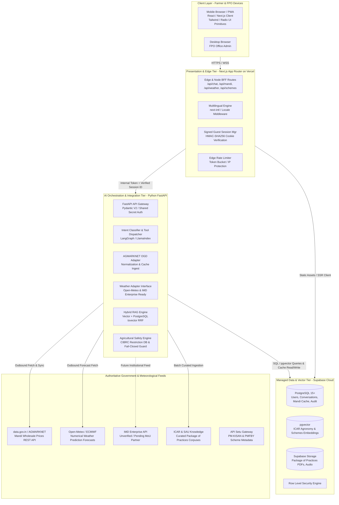
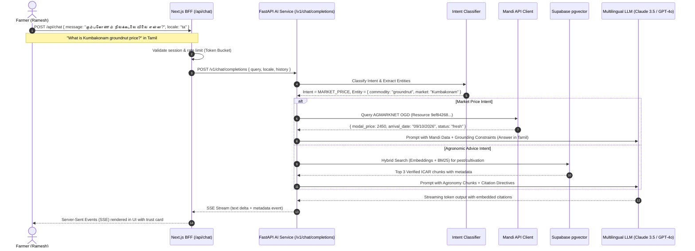

# AgriGPT — System Architecture & Data Engineering Specification

**Document Version:** 1.0.0  
**Target Architecture:** Modular Application Frontend (Next.js) + Specialized AI Orchestration Service (FastAPI) + Managed Persistence (Supabase PostgreSQL & pgvector)  
**Security Standard:** Zero-Trust Client Boundary, RLS-Enforced Storage, DPDP Act 2023 Compliant  

---

## 1. High-Level Architecture & Component Responsibilities

AgriGPT is designed as a **clean two-tier distributed system** backed by managed cloud infrastructure. It avoids premature microservice sprawl while maintaining strict separation of concerns between user-facing presentation, business logic, deterministic data aggregation, and non-deterministic AI orchestration.



### 1.1 Responsibilities Matrix

| Component | Technology | Primary Responsibilities |
|---|---|---|
| **Frontend & BFF** | Next.js App Router, TypeScript, Tailwind CSS | Client presentation, HTML streaming, localized UI catalog resolution (`next-intl`), responsive UI layouts, client input validation (Zod), cryptographic guest session signing (HMAC cookie), browser-facing rate-limiting, and forwarding typed requests to FastAPI. **Does NOT make direct outbound calls to external government or weather providers.** |
| **AI Orchestration & Integration Service** | Python 3.11, FastAPI, Pydantic V2, LlamaIndex/LangGraph | **Sole owner of external provider adapters.** Manages AGMARKNET and Weather HTTP clients, API key rotation, data normalization, cache persistence to PostgreSQL, intent routing, hybrid search orchestration, CIBRC versioned safety checks, and token streaming. |
| **Data & Storage** | Supabase PostgreSQL 15, `pgvector`, Supabase Storage | Persistent storage for farmer profiles, conversations, normalized mandi cache with composite uniqueness, vectorized agronomy chunks, and raw official PDF advisories. Protected by RLS policies. |
| **Ingestion Pipeline** | Python asynchronous batch scripts | Curated batch ingestion of official ICAR/SAU package of practices, semantic chunking, multilingual embeddings generation, and daily AGMARKNET price sync. |

---

## 2. End-to-End Request & Data Flows

### 2.1 Conversational Query Flow (Streaming with Citations)



### 2.2 Intent Routing Decision Table

| Detected Intent | Primary Action | Data Source | Fallback Action |
|---|---|---|---|
| **MARKET_PRICE** | Execute deterministic API call to AGMARKNET OGD adapter. | data.gov.in AGMARKNET dataset | If API fails or market missing, return last cached price with prominent "Data As Of [Date]" or advise nearest district mandi. |
| **WEATHER_FORECAST** | Fetch coordinate/district weather & calculate spraying window. | IMD / Open-Meteo API | Return cached daily forecast or advise contacting local KVK agromet unit. |
| **AGRONOMY_ADVICE** | Hybrid RAG search against indexed ICAR/SAU Package of Practices. | Supabase `pgvector` (`agronomy_chunks`) | If calibrated retrieval score fails model-calibrated confidence cutoff, fail closed: withhold chemical spray and suggest consulting local KVK or Agriculture Officer. |
| **SCHEME_ELIGIBILITY** | RAG search against verified Government Scheme knowledge base. | Supabase `pgvector` (`scheme_chunks`) | Provide official portal link (`myscheme.gov.in`) and toll-free helpline number. |
| **GENERAL_AGRI** | Grounded system prompt with safety guardrails. | Base LLM with strict agricultural safety prompt | Refuse medical, legal, or non-agricultural queries politely in vernacular. |

---

## 3. AI / RAG Architecture & Ingestion Workflow

```mermaid
graph TD
    subgraph IngestionWorkflow [Knowledge Ingestion & Indexing Engine]
        PDF[Official ICAR / SAU Documents<br/>e.g., TNAU Agritech Portal PDFs]
        Extract[Docling / Unstructured Parser<br/>Preserve Tables, Headings, Dosages]
        Chunk[Semantic Boundary Chunking<br/>500-800 tokens, 100 overlap]
        Meta[Metadata Enrichment<br/>Crop, Stage, Disease, Source, State]
        Embed[Multilingual Embedder<br/>text-embedding-3-small / BGE-M3]
        Index[(pgvector + tsvector<br/>HNSW Cosine Index + GIN)]
    end

    subgraph QueryWorkflow [Runtime Hybrid Retrieval]
        UserQ[User Multilingual Query] --> TransQ[Language-Preserving Query Processor]
        TransQ --> Dense[Dense Embedding Search<br/>pgvector cosine distance]
        TransQ --> Sparse[PostgreSQL Cover Density FTS<br/>ts_rank_cd on tsvector]
        Dense --> RRF[Reciprocal Rank Fusion<br/>RRF Score = w_dense / (60 + r_dense) + w_sparse / (60 + r_sparse)]
        Sparse --> RRF
        RRF --> Rerank[Cross-Encoder Re-ranker / Top 4 Chunks]
        Rerank --> ContextGen[Grounded Context Builder]
        ContextGen --> Synthesis[LLM Final Synthesis with Citations]
    end

    PDF --> Extract --> Chunk --> Meta --> Embed --> Index
    Index -.-> Dense
    Index -.-> Sparse
```

### 3.1 Ingestion Best Practices for Agricultural Texts
1. **Dosage & Table Preservation:** Chemical names (e.g., *Chlorantraniliprole 18.5% SC @ 60 ml/acre*) must not be fragmented across chunk boundaries. Chunks are split by agricultural sub-sections (Symptoms, Cultural Control, Chemical Control).
2. **Metadata Tagging:** Every chunk is tagged with:
   - `crop_name` (canonical + vernacular aliases)
   - `pest_disease_name`
   - `growth_stage` (Seedling, Vegetative, Flowering, Maturity)
   - `source_institution` (e.g., *ICAR-IARI*, *TNAU*, *UAS Dharwad*)
   - `publication_year`
   - `document_url`

### 3.2 Hybrid Search & Mathematical Rank Fusion (RRF)
PostgreSQL native full-text search uses **Cover Density Ranking** (`ts_rank_cd`) over `tsvector`, matching stemmed lexemes in Indic-supported contexts. This is merged with dense `pgvector` cosine similarity using Reciprocal Rank Fusion:
$$RRF\_Score(d) = \frac{w_{\text{dense}}}{60 + r_{\text{dense}}(d)} + \frac{w_{\text{sparse}}}{60 + r_{\text{sparse}}(d)}$$
Where $w_{\text{dense}} = 0.65$, $w_{\text{sparse}} = 0.35$, and $r(d)$ is the 1-based rank position.

### 3.3 Authoritative Agricultural Safety & Guardrails
1. **Versioned Restriction Dataset:** Backed by `cibrc_restrictions_v{YYYYMM}.json` from CIBRC.
2. **Crop-Specific Validation:** Checks chemical approval specifically for `(crop, target_pest)`.
3. **Refusal vs Generation Suppression:**
   - When a user asks about a banned substance (e.g., *"Can I use Endosulfan?"*), the system outputs an **explicit educational refusal** explaining the legal ban and recommending approved alternatives.
   - If model generation outputs an unverified chemical recommendation, the post-generation interceptor suppresses it and replaces it with verified cultural practices.
4. **Calibrated Similarity Thresholding (Fail-Closed):**
   - No arbitrary static threshold (like 0.72) is hardcoded. Cutoffs are calibrated empirically on a validation testbed of 100 agricultural queries per language.
   - If retrieved evidence falls below the calibrated high-confidence cutoff, the system **fails closed**: withholding chemical prescriptions and providing cultural management plus a referral to the local Krishi Vigyan Kendra (KVK).

---

## 4. Authentication, Authorization & Security Architecture

### 4.1 Cryptographic Guest Session & User Model
```
[Unauthenticated Guest] ----> Full read access to Chat, Mandi, Weather, Schemes.
                              Session protected via signed HTTP-only cookie
                              (agri_session = uuid.hmac_sha256).
                                    | (Optional Upgrade)
                                    v
[Registered Farmer]     ----> Authenticated via Phone OTP (Supabase Auth).
                              Profile stores district, primary crops, land size.
                              Protected by Row Level Security (RLS).
                                    | (Authorized by Admin)
                                    v
[FPO Leader / Officer]  ----> Role-based claims (role: 'fpo_manager').
                              Multi-farmer mandi comparisons, broadcast alerts.
```

### 4.2 Row Level Security (RLS) Implementation Pattern
All user tables in PostgreSQL enforce strict RLS. Sessions are isolated cryptographically:
- For registered farmers: `auth.uid() = user_id`.
- For guest farmers: Next.js verifies the HMAC cookie and forwards `X-Verified-Session-ID`, which Supabase validates against the conversation record.

```sql
-- RLS Policy for Conversations
ALTER TABLE conversations ENABLE ROW LEVEL SECURITY;

CREATE POLICY "Users and verified guest sessions can only access their own conversations"
ON conversations FOR ALL
USING (
    (auth.uid() IS NOT NULL AND user_id = auth.uid()) OR
    (auth.uid() IS NULL AND session_id = current_setting('request.jwt.claim.session_id', true))
);
```

### 4.3 Defense-in-Depth Security Boundaries
1. **No Client-Side Secrets:** Neither Next.js client bundles nor Supabase anonymous keys have access to Python AI keys, LLM credentials, or OGD API keys. All third-party calls transit server-side through FastAPI.
2. **Server-Side Secret Validation:** Environment variables are strictly validated at boot via typed schemas (`@t3-oss/env-nextjs` and `pydantic-settings`).
3. **Target Regulatory Privacy Requirements (DPDP Act 2023):**
   - System privacy standards are defined as **target regulatory requirements to be assessed and implemented** during the build:
     - Ephemeral data retention caps on guest logs.
     - Farmer consent banners on profile creation.
     - PII redaction filters scrubbing phone numbers, 12-digit Aadhaar patterns, and precise GPS coordinates from all log streams.
4. **Rate Limiting & CSP:** IP-based and session-based sliding-window rate limiting on `/api/chat` via Upstash Redis or memory bucket, plus strict Content Security Policy headers.

---

## 5. Resilience, Caching & Failure Modes

```
+-----------------------------------------------------------------------------------------+
|                                    Resilience Matrix                                    |
+-----------------------------------------------------------------------------------------+
| Failure Event         | Impact Level | System Mitigation Strategy                       |
+-----------------------------------------------------------------------------------------+
| AGMARKNET OGD         | Medium       | Fallback to Supabase daily cached price table.   |
| API Timeout (>3s)     |              | Display tag: "Showing yesterday's cached price.   |
|                       |              | Official market feed currently delayed."         |
+-----------------------+--------------+--------------------------------------------------+
| Weather Service       | Low          | Serve 12-hour cached forecast from Redis.        |
| Down / 503            |              | Banner: "Weather update delayed. Check back soon"|
+-----------------------+--------------+--------------------------------------------------+
| LLM API Outage        | High         | Fallback to secondary model provider (Anthropic  |
| (500 / Overloaded)    |              | -> OpenAI -> Gemini) via LiteLLM router.         |
+-----------------------+--------------+--------------------------------------------------+
| Client 2G / Offline   | High         | PWA Service Worker serves shell and cached mandi |
| Disconnect            |              | cards. Chat queue displays "Offline" retry pill. |
+-----------------------------------------------------------------------------------------+
```
