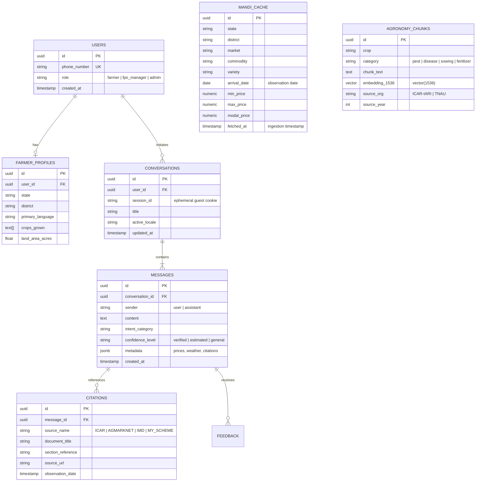

# AgriGPT — Low-Level Technical Design & API Specifications

**Document Version:** 1.0.0  
**Stack Alignment:** Next.js 14 (App Router, TypeScript, Tailwind) + Python 3.11 (FastAPI, Pydantic V2) + Supabase (PostgreSQL 15 + pgvector)  
**Standard Formats:** JSON:API / RFC 7807 (Problem Details) / OpenAPI 3.1  

---

## 1. Codebase Organization & Directory Structure

We adopt a clean, maintainable modular repository structure separating the frontend presentation/BFF from the Python AI/RAG engine while sharing strict domain schemas.

```
AgriGPT/
├── docs/                                  # Engineering & Architectural Specifications
│   ├── prd_srs.md
│   ├── ui_ux_specification.md
│   ├── system_architecture.md
│   ├── technical_design.md
│   ├── data_source_feasibility.md
│   ├── roadmap.md
│   └── risk_register.md
├── frontend/                              # Next.js 14 App Router Application
│   ├── src/
│   │   ├── app/                           # App Router routes & layouts
│   │   │   ├── [locale]/                  # Localized route tree (en, ta, hi, etc.)
│   │   │   │   ├── page.tsx               # Home & Chat Assistant Feed
│   │   │   │   ├── mandi/page.tsx         # Mandi Explorer Screen
│   │   │   │   ├── weather/page.tsx       # Weather & Agromet Advisory Screen
│   │   │   │   ├── schemes/page.tsx       # Government Schemes Screen
│   │   │   │   └── profile/page.tsx       # Farmer Settings Screen
│   │   │   ├── api/                       # Next.js BFF Route Handlers
│   │   │   │   ├── chat/route.ts          # Streaming Chat BFF Proxy
│   │   │   │   ├── mandi/route.ts         # Cached AGMARKNET Proxy
│   │   │   │   ├── weather/route.ts       # Weather Data Proxy
│   │   │   │   └── feedback/route.ts      # Farmer Feedback Endpoint
│   │   │   ├── layout.tsx                 # Root layout with font definitions
│   │   │   └── global-error.tsx           # Global error boundary
│   │   ├── components/                    # Reusable, Accessible UI Components
│   │   │   ├── shell/                     # Header, BottomNav, LanguageModal
│   │   │   ├── chat/                      # ChatFeed, Bubble, InputBar, CitationCard
│   │   │   ├── mandi/                     # MandiFilterBar, MandiPriceCard, FreshnessTag
│   │   │   ├── weather/                   # WeatherWidget, AgrometBanner
│   │   │   └── ui/                        # Button, Card, Badge, Modal, Input (Radix primitives)
│   │   ├── lib/                           # Utility functions & clients
│   │   │   ├── supabase/                  # Supabase browser & server clients
│   │   │   ├── api/                       # Typed client SDK for FastAPI
│   │   │   └── utils/                     # Formatting (currency, date, text helpers)
│   │   ├── messages/                      # Translation Catalogs (JSON)
│   │   │   ├── en.json                    # English
│   │   │   ├── ta.json                    # Tamil (தமிழ்)
│   │   │   ├── hi.json                    # Hindi (हिन्दी)
│   │   │   ├── te.json                    # Telugu (తెలుగు)
│   │   │   ├── kn.json                    # Kannada (ಕನ್ನಡ)
│   │   │   └── ml.json                    # Malayalam (മലയാളം)
│   │   └── types/                         # Shared TypeScript definitions
│   ├── tests/                             # Frontend test suite
│   │   ├── unit/                          # Vitest & RTL component tests
│   │   └── e2e/                           # Playwright end-to-end tests
│   ├── package.json
│   ├── tsconfig.json
│   └── tailwind.config.ts
├── ai_service/                            # Python FastAPI Orchestration Service
│   ├── app/
│   │   ├── api/                           # FastAPI Router endpoints
│   │   │   ├── v1/
│   │   │   │   ├── chat.py                # Streaming agent chat endpoint
│   │   │   │   ├── mandi.py               # Mandi price aggregator logic
│   │   │   │   ├── weather.py             # Agromet calculation endpoint
│   │   │   │   └── health.py              # Health check & readiness probe
│   │   ├── core/                          # Core configuration & logging
│   │   │   ├── config.py                  # Pydantic Settings (ENV validation)
│   │   │   ├── logging.py                 # Structured JSON logging
│   │   │   └── security.py                # Internal service-to-service auth
│   │   ├── db/                            # Supabase pgvector client
│   │   │   └── session.py
│   │   ├── services/                      # Domain logic & RAG engine
│   │   │   ├── rag_engine.py              # Hybrid retrieval (pgvector + BM25)
│   │   │   ├── intent_classifier.py       # Multilingual intent routing
│   │   │   ├── mandi_service.py           # OGD data normalizer & cache
│   │   │   └── guardrails.py              # Banned pesticides & fact verifier
│   │   ├── schemas/                       # Pydantic V2 Request/Response Models
│   │   └── ingestion/                     # Knowledge base processing scripts
│   │       ├── ingest_icar_pop.py         # ICAR PDF chunker and embedder
│   │       └── ingest_schemes.py          # Scheme metadata parser
│   ├── tests/                             # Python test suite
│   │   ├── test_rag.py                    # RAG retrieval quality tests
│   │   ├── test_mandi.py                  # AGMARKNET parser tests
│   │   └── test_guardrails.py             # Pesticide safety assertion tests
│   ├── pyproject.toml
│   └── Dockerfile
└── task.md                                # Prioritized Engineering Task Tracker
```

---

## 2. Database Entities & Relational Schema (PostgreSQL 15 + pgvector)



### 2.1 Core Schema DDL Definition

```sql
-- Enable necessary PostgreSQL extensions
CREATE EXTENSION IF NOT EXISTS "uuid-ossp";
CREATE EXTENSION IF NOT EXISTS "vector";

-- 1. Farmer Profiles
CREATE TABLE farmer_profiles (
    id UUID PRIMARY KEY DEFAULT uuid_generate_v4(),
    user_id UUID REFERENCES auth.users(id) ON DELETE CASCADE,
    state VARCHAR(64) NOT NULL,
    district VARCHAR(64) NOT NULL,
    primary_language VARCHAR(8) NOT NULL DEFAULT 'en',
    crops_grown TEXT[] DEFAULT '{}',
    land_area_acres NUMERIC(6, 2),
    created_at TIMESTAMPTZ NOT NULL DEFAULT NOW(),
    updated_at TIMESTAMPTZ NOT NULL DEFAULT NOW()
);

-- 2. Conversations
CREATE TABLE conversations (
    id UUID PRIMARY KEY DEFAULT uuid_generate_v4(),
    user_id UUID REFERENCES auth.users(id) ON DELETE SET NULL,
    session_id VARCHAR(128) NOT NULL,
    active_locale VARCHAR(8) NOT NULL DEFAULT 'en',
    title VARCHAR(256),
    created_at TIMESTAMPTZ NOT NULL DEFAULT NOW(),
    updated_at TIMESTAMPTZ NOT NULL DEFAULT NOW()
);
CREATE INDEX idx_conversations_session ON conversations(session_id);

-- 3. Messages with Structured Metadata
CREATE TABLE messages (
    id UUID PRIMARY KEY DEFAULT uuid_generate_v4(),
    conversation_id UUID NOT NULL REFERENCES conversations(id) ON DELETE CASCADE,
    sender VARCHAR(16) NOT NULL CHECK (sender IN ('user', 'assistant')),
    content TEXT NOT NULL,
    intent_category VARCHAR(32),
    confidence_level VARCHAR(16) CHECK (confidence_level IN ('verified', 'advisory', 'estimate', 'unknown')),
    structured_data JSONB DEFAULT '{}',
    created_at TIMESTAMPTZ NOT NULL DEFAULT NOW()
);
CREATE INDEX idx_messages_conversation ON messages(conversation_id);

-- 4. Cached Mandi Prices (Deterministic Storage with Composite Uniqueness)
CREATE TABLE mandi_prices_cache (
    id UUID PRIMARY KEY DEFAULT gen_random_uuid(),
    state VARCHAR(64) NOT NULL,
    district VARCHAR(64) NOT NULL,
    market VARCHAR(128) NOT NULL,
    commodity VARCHAR(128) NOT NULL,
    variety VARCHAR(128) NOT NULL DEFAULT 'Common',
    arrival_date DATE NOT NULL,
    min_price NUMERIC(10, 2),
    max_price NUMERIC(10, 2),
    modal_price NUMERIC(10, 2) NOT NULL,
    fetched_at TIMESTAMPTZ NOT NULL DEFAULT NOW(),
    raw_source_payload JSONB DEFAULT '{}',
    CONSTRAINT uq_mandi_record UNIQUE (state, district, market, commodity, variety, arrival_date)
);
CREATE INDEX idx_mandi_lookup ON mandi_prices_cache(state, district, commodity, arrival_date DESC);
CREATE INDEX idx_mandi_freshness ON mandi_prices_cache(arrival_date);

-- 5. Agronomy Knowledge Chunks (pgvector HNSW Index)
CREATE TABLE agronomy_knowledge_chunks (
    id UUID PRIMARY KEY DEFAULT uuid_generate_v4(),
    crop VARCHAR(64) NOT NULL,
    topic VARCHAR(64) NOT NULL, -- 'pest_management', 'fertilizer', 'sowing'
    title VARCHAR(256) NOT NULL,
    content TEXT NOT NULL,
    source_org VARCHAR(128) NOT NULL, -- 'ICAR', 'TNAU', 'UAS'
    source_url TEXT,
    publication_year INT,
    embedding VECTOR(1536), -- text-embedding-3-small dimensions
    tsv_content TSVECTOR GENERATED ALWAYS AS (to_tsvector('english', content)) STORED,
    created_at TIMESTAMPTZ NOT NULL DEFAULT NOW()
);

-- Cosine Distance HNSW Index for rapid sub-50ms vector search
CREATE INDEX idx_agronomy_hnsw ON agronomy_knowledge_chunks 
USING hnsw (embedding vector_cosine_ops) 
WITH (m = 16, ef_construction = 64);

-- Full-text GIN index for hybrid BM25-equivalent retrieval
CREATE INDEX idx_agronomy_tsv ON agronomy_knowledge_chunks USING gin (tsv_content);
```

---

## 3. API Endpoint Contracts & Schemas

### 3.1 Streaming Conversational Endpoint

**Contract:** `POST /api/chat` (Next.js BFF) -> Proxies to `POST /v1/chat/completions` (FastAPI)

#### Request Schema (JSON)
```json
{
  "conversation_id": "8a3e9c6b-29a4-4a25-a4b7-0f81d120a11e",
  "locale": "ta",
  "message": "கும்பகோணம் சந்தையில் நிலக்கடலை விலை என்ன?",
  "farmer_context": {
    "district": "Thanjavur",
    "state": "Tamil Nadu",
    "primary_crop": "Groundnut"
  }
}
```

#### Response Stream (Server-Sent Events)
```text
event: meta
data: {"intent":"MARKET_PRICE","locale":"ta","confidence":"verified"}

event: delta
data: {"text":"கும்பகோணம் ஒழுங்குமுறை விற்பனைக் கூடத்தில் "}

event: delta
data: {"text":"இன்றைய நிலக்கடலை மாதிரி விலை **₹2,450/குவிண்டால்** ஆகும்."}

event: citation
data: {"source":"AGMARKNET (OGD India)","date":"2026-10-09","market":"Kumbakonam","min_price":2200,"max_price":2600,"modal_price":2450}

event: done
data: [DONE]
```

---

### 3.2 Mandi Prices Retrieval Endpoint

**Contract:** `GET /api/mandi/prices`

#### Query Parameters:
- `state` (string, required): e.g., `Tamil Nadu`
- `district` (string, required): e.g., `Thanjavur`
- `commodity` (string, required): e.g., `Groundnut`
- `market` (string, optional): e.g., `Kumbakonam`

#### Response Schema (`200 OK`)
```json
{
  "success": true,
  "data": {
    "state": "Tamil Nadu",
    "district": "Thanjavur",
    "commodity": "Groundnut",
    "markets": [
      {
        "market_name": "Kumbakonam Regulated Market",
        "variety": "Local",
        "arrival_date": "2026-10-09",
        "arrival_quantity_tonnes": 14.5,
        "prices": {
          "min": 2200.0,
          "max": 2600.0,
          "modal": 2450.0,
          "unit": "INR/Quintal"
        },
        "freshness": "FRESH",
        "is_stale": false
      }
    ],
    "source": {
      "provider": "AGMARKNET / Directorate of Marketing & Inspection",
      "portal": "data.gov.in",
      "resource_id": "9ef84268-d588-465a-a308-a864a43d0070",
      "retrieved_at": "2026-10-10T13:40:00Z"
    }
  }
}
```

---

### 3.3 Weather & Agromet Advisory Endpoint

**Contract:** `GET /api/weather/forecast`

#### Query Parameters:
- `district` (string, required): e.g., `Thanjavur`
- `state` (string, required): e.g., `Tamil Nadu`
- `lat` (float, optional): `10.7870`
- `lon` (float, optional): `79.1378`

#### Response Schema (`200 OK`)
```json
{
  "success": true,
  "data": {
    "location": {
      "district": "Thanjavur",
      "state": "Tamil Nadu",
      "coordinates": { "lat": 10.787, "lon": 79.1378 }
    },
    "current": {
      "temperature_c": 31.2,
      "relative_humidity_pct": 72,
      "wind_speed_kmh": 8.4,
      "condition": "Partly Cloudy",
      "precipitation_prob_pct": 15
    },
    "agromet_advisory": {
      "spraying_suitability": "FAVORABLE",
      "delta_t_c": 4.2,
      "wind_speed_kmh": 8.4,
      "wind_gusts_kmh": 12.1,
      "rain_prob_next_6h_pct": 5,
      "advisory_text_en": "Estimated favorable spraying window: Delta T (4.2°C) and wind (8.4 km/h) are within optimal ranges. No wash-off rain expected in next 6 hours.",
      "pollinator_warning_en": "Avoid spraying flowering crops during peak bee activity hours (09:00 - 15:00).",
      "disclaimer_en": "Weather suitability estimate based on numerical weather prediction models. Field conditions may vary. Always verify on-site wind direction and product label rainfastness before application.",
      "irrigation_advice_en": "No significant rainfall expected. Schedule regular light irrigation for groundnut crops.",
      "heat_stress_alert": false
    },
    "daily_forecast": [
      {
        "date": "2026-10-10",
        "temp_max_c": 33.0,
        "temp_min_c": 25.0,
        "rain_sum_mm": 0.0,
        "rain_probability_pct": 10
      },
      {
        "date": "2026-10-11",
        "temp_max_c": 32.5,
        "temp_min_c": 24.5,
        "rain_sum_mm": 2.1,
        "rain_probability_pct": 35
      }
    ],
    "source_attribution": {
      "data_type": "NUMERICAL_MODEL_FORECAST",
      "provider": "Open-Meteo NWP (ECMWF / GFS)",
      "license": "Creative Commons Attribution 4.0 International (CC BY 4.0)",
      "attribution_text": "Weather forecast data provided by Open-Meteo.com",
      "model_run_time": "2026-10-10T06:00:00Z"
    }
  }
}
```

---

### 3.4 Standard Error Response Contract (RFC 7807)

Every non-2xx response from either Next.js BFF or FastAPI adheres to RFC 7807 problem details:

```json
{
  "type": "https://agrigpt.samunnati.com/errors/mandi-source-unavailable",
  "title": "Mandi Data Source Temporarily Unavailable",
  "status": 503,
  "detail": "Upstream AGMARKNET OGD portal did not respond within the 3000ms SLA. Cached fallback price served.",
  "instance": "/api/mandi/prices?district=Thanjavur&commodity=Groundnut",
  "code": "MANDI_UPSTREAM_TIMEOUT",
  "timestamp": "2026-10-10T13:42:00Z"
}
```

---

## 4. Validation, Logging, Testing & Observability Strategy

### 4.1 Schema Validation Layer
- **Client & BFF (TypeScript):** Zod v3 validates all form inputs, route parameters, and deserialized API responses.
- **AI Service (Python):** Pydantic V2 (`BaseModel`, `Field`) enforces strict request models with explicit coercion and constraint checks (e.g., latitude bounds, non-empty search terms).

### 4.2 Logging & Tracing
- **Correlation IDs:** Every incoming client request receives an `X-Request-ID` header generated at the Next.js edge and propagated downstream to FastAPI and Supabase queries.
- **Structured JSON Logging:** Both frontend (Pino) and Python AI service (structlog) emit newline-delimited JSON logs with fields: `level`, `timestamp`, `request_id`, `locale`, `intent`, `latency_ms`, and `user_id`.
- **Sensitive Data Redaction:** Explicit sanitizer masks phone numbers, OTPs, and exact GPS home coordinates before writing to logs.

### 4.3 Automated Testing Matrix
1. **Frontend Unit & Component Testing:**
   - Framework: `Vitest` + `@testing-library/react`.
   - Scope: Render verification, language switcher behavior, accessible ARIA attributes, and 320px viewport layout integrity.
2. **End-to-End Testing:**
   - Framework: `Playwright`.
   - Scope: Multi-step farmer user journeys in English, Tamil, and Hindi; offline network simulation; streaming chat completion verification.
3. **Python AI Service Testing:**
   - Framework: `pytest` + `pytest-asyncio`.
   - Scope: AGMARKNET response parsing, intent classifier confusion matrix, pgvector hybrid retrieval ranking, and anti-hallucination guardrail assertions.
