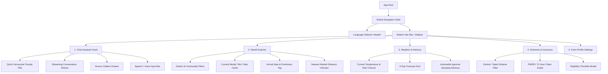

# AgriGPT — UI/UX Specification & Design System

**Document Version:** 1.0.0  
**Target Platform:** Mobile-First Web Application (Progressive Web App Ready)  
**Visual Identity:** Professional Agricultural Intelligence (Samunnati Ecosystem)  
**Supported Languages:** English, Tamil, Hindi, Malayalam, Telugu, Kannada  

---

## 1. Brand Identity & Design Philosophy

AgriGPT is designed to convey **scientific authority, institutional trust, and radical accessibility**. It rejects playful generic bot aesthetics in favor of a clean, purposeful, field-tested agricultural utility.

### 1.1 Core UX Tenets
1. **Farmer-First Clarity:** Zero agronomic jargon without explanation. Short, readable paragraphs with bold key figures (e.g., **₹2,450/quintal**).
2. **Thumb-Driven Ergonomics:** 80% of farmers use smartphones single-handedly in outdoor field conditions. All high-frequency actions reside within the natural bottom thumb zone.
3. **Radical Transparency:** Every fact is labeled with its origin (AGMARKNET, ICAR, IMD), collection timestamp, and confidence status.
4. **Resilient Under Glare & Low Contrast:** High-contrast text tokens, daylight-readable color ratios (WCAG AA compliance >= 4.5:1), and zero faint grays.

---

## 2. Design System Tokens & Color Palette

### 2.1 Color Tokens

```
+----------------------------------------------------------------------------------------+
|                                    AgriGPT Palette                                     |
+----------------------------------------------------------------------------------------+
  Primary Emerald        Deep Earth Ochre       Daylight Neutral       Dark Slate (Text)
  #15803D (green-700)    #B45309 (amber-700)    #F8FAF5 (warm husk)    #0F172A (slate-900)
       [Growth]                [Harvest]              [Surface]              [High-Legibility]
```

| Token Name | Hex Code | Tailwind Equivalent | Semantic Purpose |
|---|---|---|---|
| `agri-primary` | `#15803D` | `green-700` | Primary branding, buttons, active states, verified badges |
| `agri-primary-hover` | `#166534` | `green-800` | Interactive press/hover state |
| `agri-primary-light` | `#DCFCE7` | `green-100` | Badge backgrounds, accent highlights, callout cards |
| `agri-accent` | `#B45309` | `amber-700` | Mandi price highlights, harvest alerts, market linkage |
| `agri-accent-light` | `#FEF3C7` | `amber-100` | Warning tags, stale data indicators, scheme notices |
| `agri-surface-bg` | `#F8FAF5` | Custom warm | Application background (reduces glare under sun) |
| `agri-card-bg` | `#FFFFFF` | `white` | Surface for elevated content cards and modals |
| `agri-text-primary` | `#0F172A` | `slate-900` | Primary headlines, body text (Contrast ratio > 12:1) |
| `agri-text-muted` | `#475569` | `slate-600` | Secondary labels, dates, disclaimers (Contrast > 4.8:1) |
| `agri-border` | `#E2E8F0` | `slate-200` | Dividers, card boundaries, input strokes |
| `agri-danger` | `#DC2626` | `red-600` | Severe weather warnings, banned pesticide alerts |

### 2.2 Typography & Indic Script Font Stack
Indian regional languages (Tamil, Telugu, Kannada, Hindi, Malayalam) feature complex conjuncts and vertical ascenders/descenders. Standard English line-heights cause glyph clipping.

```css
/* Typography Stack */
--font-fallback: -apple-system, BlinkMacSystemFont, "Segoe UI", Roboto, sans-serif;
--font-english: "Inter", var(--font-fallback);
--font-tamil: "Noto Sans Tamil", var(--font-fallback);
--font-hindi: "Noto Sans Devanagari", var(--font-fallback);
--font-telugu: "Noto Sans Telugu", var(--font-fallback);
--font-kannada: "Noto Sans Kannada", var(--font-fallback);
--font-malayalam: "Noto Sans Malayalam", var(--font-fallback);
```

#### Line Height & Body Size Rules:
- **Minimum Body Size:** `16px` (`text-base`). Prevents iOS mobile viewport auto-zooming on focus and aids older farmers with presbyopia.
- **Indic Script Line-Height:** `1.65` (165%) minimum (compared to 1.5 in English) to avoid ligature truncation.
- **Type Scale:**
  - Display Title: `24px` (`text-2xl`), Semibold (`font-semibold`)
  - Section Header: `20px` (`text-xl`), Medium (`font-medium`)
  - Card Title / Data Value: `18px` (`text-lg`), Bold (`font-bold`)
  - Body Text: `16px` (`text-base`), Regular (`font-normal`)
  - Captions / Metadata: `13px` (`text-xs`), Medium (`font-medium`)

---

## 3. Information Architecture (IA)



---

## 4. Proposed Screen Inventory

### Screen 1: Language Switcher Modal (First-Time & Global Access)
- **Trigger:** First visit without cookie or manual tap on top right flag/language pill.
- **Visuals:** Grid of 6 tactile, high-contrast cards displaying the language name in its native script and English:
  - `English` (English)
  - `தமிழ்` (Tamil)
  - `हिन्दी` (Hindi)
  - `മലയാളം` (Malayalam)
  - `తెలుగు` (Telugu)
  - `ಕನ್ನಡ` (Kannada)
- **Behavior:** Instant client-side state update + cookie persistence (`NEXT_LOCALE`), no full page reload, transitions smoothly into localized home feed.

### Screen 2: Conversational Intelligence Feed (Primary Home)
- **Top Header:** Clean Samunnati + AgriGPT badge, selected district pill (e.g., `📍 Thanjavur, TN`), language selector trigger.
- **Prompt Suggestion Rail:** Horizontally scrollable vernacular prompt pills:
  - *"🌾 Groundnut mandi price today"*
  - *"🐛 Fall armyworm spray for maize"*
  - *"🌧️ Is today good for pesticide spraying?"*
  - *"📋 How to claim PMFBY crop insurance?"*
- **Message List:**
  - Farmer Bubble: Right-aligned, subtle green tint, clean typography.
  - AgriGPT Bubble: Left-aligned, white card with border, structured markdown (headers, bullet points, bold figures).
  - **Trust Card:** Integrated card footer showing:
    - `Verified Source:` e.g., *ICAR Package of Practices / AGMARKNET*
    - `Timestamp:` e.g., *Oct 09, 2026, 06:00 PM*
    - `Confidence Badge:` `[Verified Fact]` (Green), `[Agromet Advisory]` (Blue), `[Estimate]` (Amber).
  - **Action Tools:** Copy text, Listen (TTS Audio trigger), Share to WhatsApp button.
- **Input Bar (Sticky Bottom):**
  - Multilingual placeholder: *"Ask about crops, prices, weather..."* (localized).
  - Mic icon for voice input (Web Speech API / speech recording).
  - Send button with high-contrast active state.

### Screen 3: Mandi Price Explorer
- **Search & Filters:**
  - State dropdown (pre-filled from profile).
  - District dropdown.
  - Commodity search with regional synonym matching (e.g., typing *"Godhumai"* finds *"Wheat"*).
- **Price Card (Primary Result):**
  - Large price display: **₹2,450 / Quintal** (Modal Price).
  - Min / Max range indicator bar: `Min: ₹2,200` | `Max: ₹2,600`.
  - Market Name: `Thanjavur Regulated Market`.
  - Date Badge: `📅 Arrival: Oct 09, 2026` (Green if today/yesterday; Amber warning if > 48h).
  - Distance: `🚗 14 km from your farm`.

### Screen 4: Weather & Agromet Advisory Center
- **Hero Weather Card:**
  - Current Temperature, Rain Probability (`%`), Humidity, Wind Speed (`km/h`).
- **Operational Spraying & Irrigation Window:**
  - Highlighting banner:
    - 🟢 **Spraying Favorable:** Low wind (< 10 km/h), no rain predicted for next 18 hours.
    - 🔴 **Hold Spraying:** 75% rain probability at 3:00 PM today.
- **5-Day Micro-Forecast:** Compact horizontal day cards (Sun/Cloud/Rain icons, Max/Min temp, Rain mm).

### Screen 5: Schemes & Insurance Finder
- **Category Filter Tabs:** `All Schemes`, `Income Support (PM-KISAN)`, `Insurance (PMFBY)`, `Solar / Irrigation`, `Organic & Seeds`.
- **Scheme Card:**
  - Scheme Name + Department crest/icon.
  - Benefit Amount (e.g., `₹6,000 / year in 3 installments`).
  - Key Eligibility: Landowner farmer, active Aadhaar eKYC.
  - Required Documents list (Land Patta/Chitta, Bank Passbook, Aadhaar).
  - Direct Official Link to government portal.

---

## 5. Mobile-First Interaction Flows & Responsive Layout

### 5.1 Responsive Breakpoint Matrix

| Viewport | Device Class | Layout Adaptation |
|---|---|---|
| **320px - 414px** | Budget / Standard Android (Primary) | Full-width single column; sticky bottom navigation; compact prompt pills; full-width modal drawers. |
| **415px - 767px** | Large Phones / Phablets | 2-column mandi price comparison cards; side-by-side weather stat chips. |
| **768px - 1024px** | Tablets / FPO Field Devices | Split-screen layout: Chat feed on left (60%), Mandi & Weather widgets on right (40%). |
| **1025px+** | Desktop (FPO Office / Lead Farmer) | Permanent left sidebar navigation; wide-screen 3-column dashboard; multi-mandi table view with CSV export. |

### 5.2 320px Viewport Critical Constraints
- **Zero Fixed-Width Overflow:** All card elements use `w-full max-w-full min-w-0` and `truncate` or `break-words`.
- **Touch Target Cushioning:** Minimum button size `48px x 48px` with `8px` gap between interactive controls to prevent accidental mis-taps.
- **Horizontal Scroll Indicators:** Any horizontal rail (prompt chips, forecast days) includes a subtle gradient mask on the right edge signaling scrollability.

---

## 6. Accessibility & Multilingual UX Strategy

### 6.1 Localization Beyond Text Translation
Localization in AgriGPT is **deep**, not superficial:
1. **Number & Currency Formatting:**
   - English: `₹2,450 / quintal`
   - Tamil: `₹2,450 / குவிண்டால்`
   - Hindi: `₹2,450 / क्विंटल`
   - Indian grouping system (`1,00,000` instead of `100,000`).
2. **Text Expansion Budget:**
   - German and Indian languages (especially Telugu, Kannada, and Malayalam) expand text length by **25% to 45%** compared to English.
   - *Example:* "View Prices" (11 chars) -> Tamil: "விலைகளைப் பார்க்கவும்" (23 chars).
   - *Design Rule:* Never use fixed pixel button widths (`w-32`). All buttons use `w-auto px-4 py-2 flex items-center justify-center text-center`.
3. **Screen Reader Semantic Tree:**
   - All icon-only buttons (Mic, Send, Language Switch) carry strict `aria-label` tags translated into the active language.
   - Factual badges carry `aria-live="polite"` for dynamic updates.

---

## 7. Component Inventory & Specification

```
+----------------------------------------------------------------------------------------+
|                               Reusable Component Hierarchy                             |
+----------------------------------------------------------------------------------------+
  ├── [Shell]
  │    ├── AppHeader (Brand Logo, DistrictPill, LanguageDropdown)
  │    └── BottomNav (Icon + Label, 4 fixed tabs, active indicator)
  ├── [Conversation]
  │    ├── ChatFeed (Virtual scrolling list, message bubbles)
  │    ├── MessageBubble (Markdown parser, syntax highlighter, trust badge)
  │    ├── CitationAccordion (Collapsible ICAR/AGMARKNET source details)
  │    ├── PromptPillRail (Horizontal suggestion chips)
  │    └── ChatInputBar (Textarea auto-resize, AudioRecordButton, SendButton)
  ├── [Mandi]
  │    ├── MandiFilterBar (State, District, Commodity searchable selects)
  │    ├── MandiPriceCard (Modal/Min/Max, Arrival Date, Freshness Badge)
  │    └── FreshnessIndicator (Green: Today, Amber: 2-3d, Red: Stale)
  ├── [Weather]
  │    ├── CurrentWeatherWidget (Temperature, Humidity, Rain probability)
  │    ├── AgrometAlertBanner (Actionable farm spraying/irrigation advice)
  │    └── ForecastDayCard (Compact 5-day outlook chip)
  └── [Feedback & Trust]
       ├── FactBadge (Verified / Estimate / Caution)
       ├── ErrorState (Friendly vernacular failure message + retry button)
       └── OfflineBanner (Dismissible persistent indicator when offline)
```

Each component is implemented using strict TypeScript types and accessible primitives (Radix UI / Headless UI patterns styled with Tailwind CSS).
